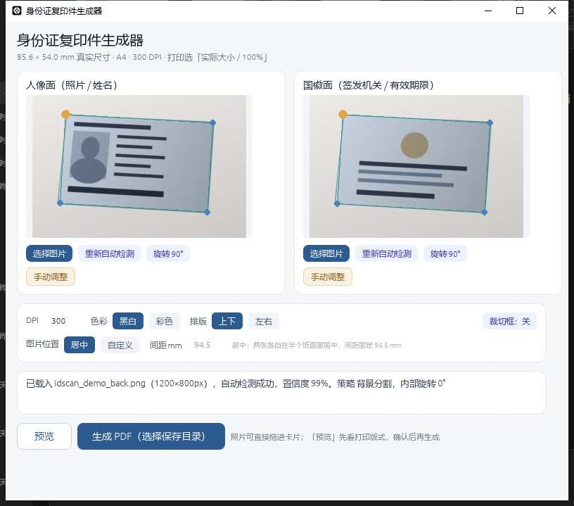
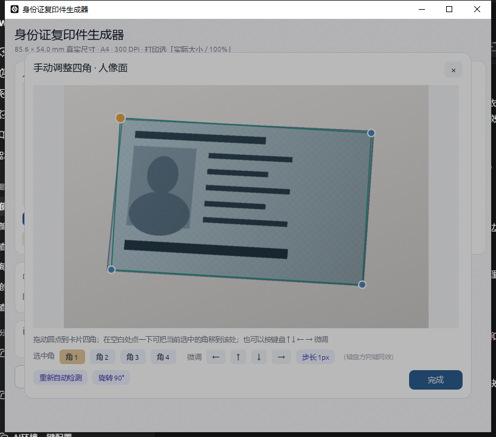

# 身份证复印件生成器 · 安装包发布

本仓库**仅用于发布编译好的安装包与版本说明，不包含源代码**（源代码仓库保持私有）。

请前往 [Releases](https://github.com/Leenshady/chinese-idcard-scan-releases/releases) 页面下载最新版本。

## 界面预览

### 主界面



### 手动调整四角



## v1.0.0 下载

| 文件 | 平台 | 说明 |
| --- | --- | --- |
| `IdScan-1.0.0-win64.zip` | Windows x64 | 桌面版便携包，解压后运行 `IdScan.exe` |
| `idscan-cli-1.0.0-win64.exe` | Windows x64 | 命令行工具，支持 `--detect` 与四角参数、PDF 输出 |
| `idscan-kylin-arm64_1.0.0_arm64.deb` | 麒麟 OS ARM64 | deb 安装包 |
| `idscan-kylin-arm64-1.0.0.tar.gz` | 麒麟 OS ARM64 | 免安装压缩包，执行目录内 `install.sh` |
| `SHA256SUMS.txt` | 通用 | 上述四个安装包的 SHA-256 校验值 |

## 校验下载文件

Linux / 麒麟：

```bash
sha256sum -c SHA256SUMS.txt
```

Windows（PowerShell）：

```powershell
certutil -hashfile <文件名> SHA256
```

## 主要功能

- 自动检测身份证四角：Hough 直线投票 + 亚像素边缘精修，40 例合成基准 40/40 命中
- 按 ISO/IEC 7810 ID-1 标准生成 3.18 mm 圆角，透视矫正后输出 A4 排版 PDF
- 竖拍照片自动转正 90°，四角可手动拖拽微调
- 上下 / 左右排版，居中 / 自定义间距
- 点击图片区域选图，一键重新自动检测、旋转、手动调整

## 说明

- 作者：cnleen9
- 麒麟 ARM64 版本已逐字节校验 ELF 结构与 deb / tar 包结构（GLIBC ≤ 2.30），界面行为在同源桌面端验证，尚未在真实 ARM 设备实机运行
- 使用问题与反馈请在本仓库提交 Issue
